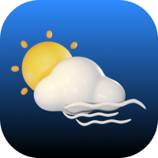

# WeatherNow

A clean, professional weather application that provides real-time weather information based on the user's location or searched city. Built with vanilla HTML, CSS, and JavaScript.



## Features

✨ **Real-time Weather Data**
- Current temperature, humidity, wind speed, and weather conditions
- Feels-like temperature and atmospheric pressure
- Visibility and cloudiness information
- Sunrise and sunset times

🌍 **Location Services**
- Automatic weather detection using your current location
- Search for any city worldwide
- Accurate geolocation-based weather

🎨 **Professional UI/UX**
- Clean, modern interface design
- Dynamic weather-based backgrounds
- Smooth animations and transitions
- Fully responsive (mobile, tablet, desktop)
- Animated weather icons

🚀 **Simple & Fast**
- Single-page application
- No unnecessary features
- Fast loading times
- Clean, maintainable code

## Demo

The app displays:
- **Temperature** in Celsius with feels-like temperature
- **Weather Description** with animated icons
- **Wind Speed** in meters per second
- **Humidity** percentage
- **Atmospheric Pressure** in hPa
- **Visibility** in kilometers
- **Cloudiness** percentage
- **Sunrise/Sunset** times

## Technologies Used

- **HTML5** - Semantic markup
- **CSS3** - Modern styling with CSS Grid and Flexbox
- **JavaScript (ES6+)** - Async/await, Promises, DOM manipulation
- **OpenWeatherMap API** - Real-time weather data
- **Font Awesome** - Icon library
- **Google Fonts (Inter)** - Typography

## Installation

1. **Clone the repository**
```bash
git clone https://github.com/kaushalsahu07/weather.git
cd weather
```

2. **Add your API key**
   - Open `js/app.js`
   - Replace the API key on line 3:
```javascript
const API_KEY = "your_api_key_here";
```
   - Get a free API key from [OpenWeatherMap](https://home.openweathermap.org/api_keys)

3. **Open the app**
   - Simply open `index.html` in your web browser
   - Or use a local server (recommended):
```bash
# Using Python
python -m http.server 8000

# Using Node.js
npx serve
```

4. **Start using**
   - Allow location access for automatic weather detection
   - Or search for any city manually

## Project Structure

```
weather-app/
├── index.html          # Main HTML file
├── css/
│   └── style.css       # All styles (responsive design)
├── js/
│   └── app.js          # Application logic
├── img/                # Weather icons
│   ├── sun.png
│   ├── cloud.png
│   ├── rain.png
│   ├── snow.png
│   ├── mist.png
│   ├── haze.png
│   ├── thunderstorm.png
│   └── icon.png
└── README.md
```

## Usage

### Using Current Location
1. Click the location button (📍) or wait for automatic detection
2. Allow location access when prompted
3. Weather for your location will be displayed

### Searching for a City
1. Type a city name in the search bar
2. Click the search button (🔍) or press Enter
3. Weather for that city will be displayed

## Features Breakdown

### Weather Information Displayed
- **Temperature**: Current temperature with large, easy-to-read display
- **Feels Like**: What the temperature actually feels like
- **Weather Condition**: Clear description with icon
- **Humidity**: Moisture level in the air
- **Wind Speed**: Current wind speed
- **Pressure**: Atmospheric pressure
- **Visibility**: How far you can see
- **Cloudiness**: Percentage of cloud cover
- **Sunrise/Sunset**: Accurate times based on location

### Dynamic Backgrounds
The app changes its background gradient based on weather conditions:
- ☀️ **Clear Sky** - Purple gradient
- ☁️ **Cloudy** - Gray gradient
- 🌧️ **Rain** - Blue gradient
- ❄️ **Snow** - Cold white-gray gradient
- ⛈️ **Thunderstorm** - Dark dramatic gradient
- 🌫️ **Mist/Fog** - Atmospheric gradient

### Responsive Design
- **Desktop**: Full-width layout with grid-based details
- **Tablet**: Optimized for medium screens
- **Mobile**: Compact layout with touch-friendly buttons

## API Reference

This app uses the [OpenWeatherMap API](https://openweathermap.org/api):

- **Current Weather Data**: `api.openweathermap.org/data/2.5/weather`
- **Parameters**: 
  - `q`: City name
  - `lat` & `lon`: Coordinates
  - `units`: metric (Celsius)
  - `appid`: Your API key

## Browser Support

- ✅ Chrome (latest)
- ✅ Firefox (latest)
- ✅ Safari (latest)
- ✅ Edge (latest)
- ✅ Mobile browsers

## Code Quality

- ✅ Clean, readable code
- ✅ Modern JavaScript (ES6+)
- ✅ No external dependencies except Font Awesome
- ✅ Proper error handling
- ✅ Loading states
- ✅ User-friendly error messages
- ✅ Semantic HTML
- ✅ CSS custom properties for easy theming
- ✅ Smooth animations

## Contributing

Contributions are welcome! Feel free to:
1. Fork the repository
2. Create a feature branch
3. Make your changes
4. Submit a pull request

## Future Enhancements

Potential features to add:
- [ ] 5-day forecast
- [ ] Hourly forecast
- [ ] Multiple city tracking
- [ ] Temperature unit toggle (°C/°F)
- [ ] Weather alerts
- [ ] Historical data
- [ ] Weather maps
- [ ] Dark mode toggle

## License

This project is open source and available for educational purposes.

## Contact

**Kaushal Sahu**
- 📧 Email: [kaushalsahu.me@gmail.com](mailto:kaushalsahu.me@gmail.com)
- 💼 GitHub: [@kaushalsahu07](https://github.com/kaushalsahu07)
- 🔗 LinkedIn: [@kaushalsahu07](https://www.linkedin.com/in/sahukaushal)
- 📸 Instagram: [@cd.kaushal](https://www.instagram.com/cd.kaushal)
- 🌐 Portfolio: [Website](https://kaushalsahu07.github.io/portfolio/)
- 🐦 X (Twitter): [@kaushalsahu_07](https://x.com/kaushalsahu_07)

---

Made with ❤️ by Kaushal Sahu | Powered by [OpenWeatherMap](https://openweathermap.org/)
